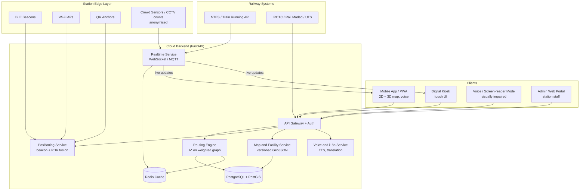
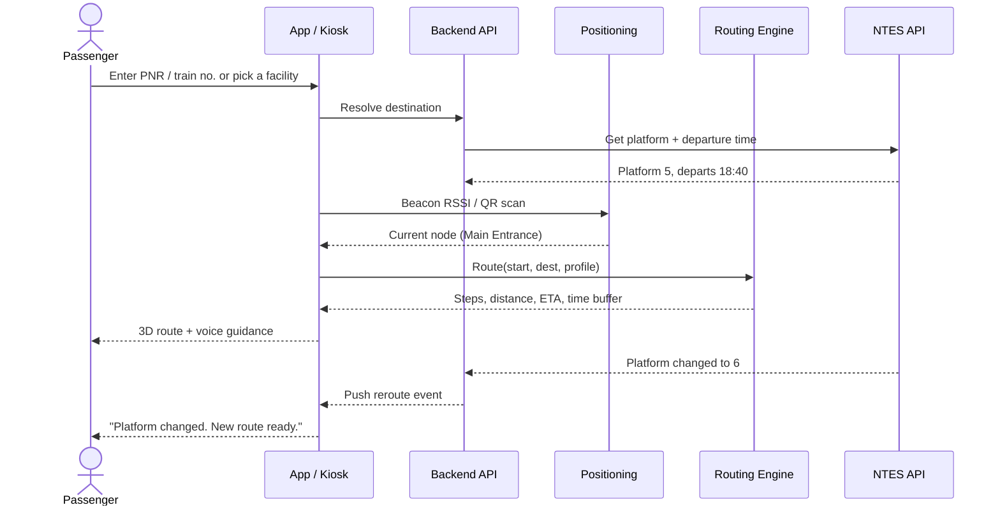
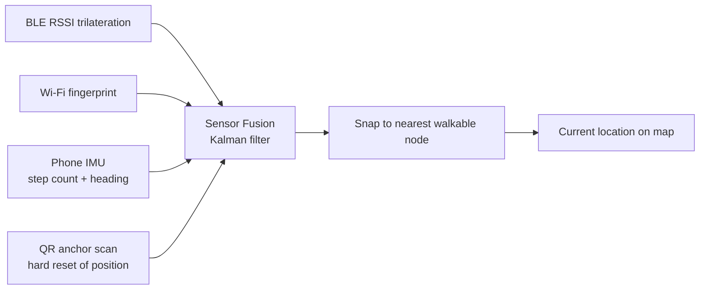
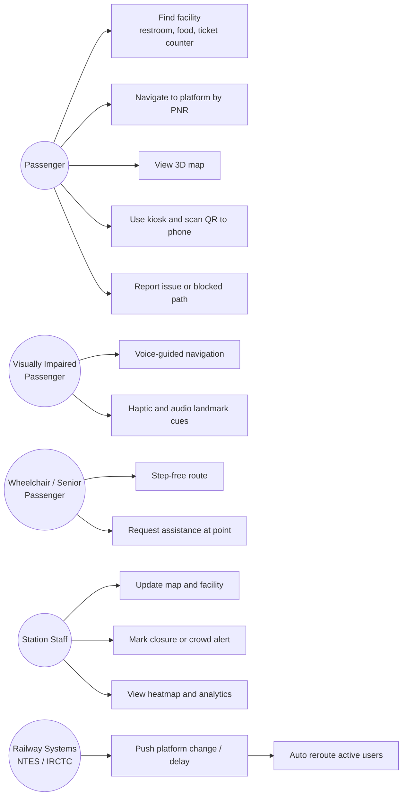
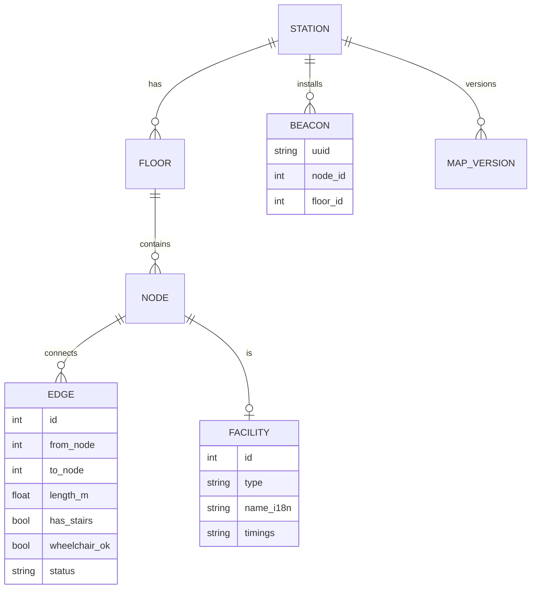

# StationSathi: Indoor Navigation for Railway Stations

**SIH 1710: Enhancing Navigation for Railway Station Facilities and Locations**
Organization: Ministry of Railways | Category: Software | Theme: Transportation & Logistics

> *"Sathi" means companion. StationSathi guides every passenger, sighted or not, from the station entrance to the right platform, coach position and facility, in their own language.*

---

## 1. Problem Statement

Large railway stations have many platforms, foot-over-bridges, ticket counters, restrooms, food courts, waiting halls, lifts and exits. Passengers, especially first-time travellers, senior citizens, Divyangjan and people who do not read English or Hindi, lose time and miss trains because:

- GPS does not work indoors, so Google Maps is useless inside a station.
- Static signboards go out of date when platforms change or construction closes a passage.
- Existing railway apps tell you *which* platform, not *how to get there*.
- Nothing accounts for wheelchair-accessible or step-free routes, or for visually impaired users.

## 2. Idea

A single navigation platform that serves **mobile (PWA/app), digital kiosks and voice** from one backend and one map source of truth. Its main differences from a plain "indoor map app":

| # | Differentiator | What it gives the passenger |
|---|---|---|
| 1 | **Time-aware routing** | Estimates walking time for each route and compares it with the train's departure time ("Leave now, 7 min to Platform 5, 14 min left") |
| 2 | **Accessibility profiles** | Separate routing for wheelchair (lifts/ramps only), elderly (fewer stairs), visually impaired (landmark-based audio) and normal users |
| 3 | **Live platform change reroute** | If NTES reports a platform change, the active route is recalculated and pushed to the user |
| 4 | **Crowd and closure aware** | Edge weights rise on crowded or blocked paths, and the route switches |
| 5 | **Position without GPS** | BLE beacons and Wi-Fi, with QR "You are here" anchors at kiosks and pillars as a fallback |
| 6 | **Offline-first** | Station map pack is cached on the phone, so navigation works in poor network |
| 7 | **Multilingual voice** | Turn-by-turn audio in English, Hindi, Tamil and other regional languages |
| 8 | **Kiosk to phone handoff** | A route planned on a kiosk is carried onto the phone by scanning a QR code |
| 9 | **Admin CMS** | Station staff edit the map (close a gate, move a counter) and it goes live without an app update |

## 3. Proposed Solution

### 3.1 System Architecture



### 3.2 Layered view

| Layer | Responsibility |
|---|---|
| Presentation | Mobile PWA, kiosk UI, voice mode, admin portal |
| Service | Routing, positioning, map, realtime, voice/i18n |
| Data | Station graph, facilities, map versions, analytics |
| Integration | NTES (platform and delay), IRCTC / UTS (PNR and ticket), Rail Madad |
| Edge | BLE beacons, Wi-Fi, QR anchors, crowd counters |

### 3.3 Route request flow



### 3.4 Routing algorithm

The station is modelled as a **graph**: nodes are doors, junctions, stairs, lifts, escalators and facilities; edges are walkable segments per floor.

```
cost(edge) = distance / walking_speed
           + stairs_penalty      (infinite for wheelchair profile)
           + crowd_penalty       (from live density)
           + closure_penalty     (infinite if blocked)
```

- **A\*** with a straight-line heuristic gives the shortest valid path in milliseconds.
- Profiles change the edge filters and weights (wheelchair, elderly, visually impaired, normal).
- Floors are linked by lift, escalator and stair edges, so multi-level routing works.

### 3.5 Positioning without GPS



If beacons are not installed yet, **QR anchors plus step-counting** still give usable navigation, so the system can be rolled out in phases.

## 4. Use Cases

### 4.1 Use case diagram



### 4.2 Scenario table

| # | Actor | Scenario | Outcome |
|---|---|---|---|
| 1 | First-time traveller | Enters PNR and the app finds Platform 4, then gives the route and ETA | Reaches the platform with time to spare |
| 2 | Wheelchair user | Selects the accessible profile, and the route uses lifts and ramps only | No stairs, no detours |
| 3 | Visually impaired user | Voice mode: "Walk 20 metres straight, the lift is on your left" | Independent travel |
| 4 | Elderly passenger at kiosk | Chooses the destination on the kiosk, scans the QR and the route opens on the phone, or reads the printed step list | No typing needed |
| 5 | Any passenger | Platform changes from 5 to 6 mid-route | Instant reroute notification |
| 6 | Station master | Closes the FOB-2 stairs for repair in the admin portal | All routes avoid it within seconds |
| 7 | Passenger in a rush | Asks "nearest restroom or water" | Shows the nearest by walking distance, not straight line |
| 8 | Passenger in a poor network area | Offline map pack is used | Navigation continues |

## 5. Technology Stack

| Area | Technology |
|---|---|
| Mobile / Web | React + Vite PWA (Flutter optional), service workers for offline |
| 3D / 2D Maps | MapLibre GL JS (indoor floor layers) + Three.js for 3D walkthrough |
| Kiosk | Same React app in fullscreen kiosk mode (Chromium), touch-optimised, large-font UI |
| Backend | Python FastAPI, WebSocket, Celery for background jobs |
| Routing | NetworkX / custom A* with weighted edges |
| Database | PostgreSQL + PostGIS; Redis for cache and pub/sub |
| Positioning | BLE beacons (iBeacon/Eddystone), Web Bluetooth / native plugin, IMU sensors, QR |
| Voice | Web Speech API / Android TTS, Bhashini (Govt. of India) for Indian-language translation & TTS |
| Realtime | WebSocket, MQTT for IoT counters |
| Auth | JWT, role-based access (passenger / staff / admin) |
| DevOps | Docker, GitHub Actions CI, deployment on Railway/AWS/NIC cloud |
| Maps data | Station floor plans converted to GeoJSON via admin editor |

## 6. Dependencies

**External systems**
- NTES / Indian Railways running-status API for platform and delay data
- IRCTC / UTS for PNR and ticket details (via official integration)
- Bhashini API for Indian language speech and translation
- Station Wi-Fi and BLE beacon hardware

**Software libraries**
- `fastapi`, `uvicorn`, `sqlalchemy`, `geoalchemy2`, `networkx`, `redis`, `websockets`
- `react`, `maplibre-gl`, `three`, `workbox` (offline)

**Assumptions**
- Floor plans can be provided by the station authority
- Beacons can be installed at key points (about one per 15 to 20 m)

## 7. Accessibility and Inclusion

- WCAG 2.1 AA colour contrast, large text and a high-contrast mode
- Screen-reader labels on every control (TalkBack / VoiceOver)
- Voice-first flow: speak the destination, hear the directions
- Landmark-based instructions ("pass the enquiry counter") instead of only distances
- Haptic vibration patterns for turns
- Kiosks at wheelchair height with a tactile button and an audio jack
- Languages: English, Hindi, Tamil, Telugu, Bengali and more through Bhashini

## 8. Real-time Update Mechanism

1. Staff edit the map in the admin portal. A new **map version** is stored in PostGIS.
2. The backend publishes a `map.updated` event to Redis and WebSocket.
3. Clients download only the changed tiles and graph delta.
4. Route caches are invalidated and active users are rerouted.
5. NTES platform and delay events follow the same pipeline.

## 9. Database Design (core tables)



## 9.1 API Endpoints (sample)

| Method | Endpoint | Purpose |
|---|---|---|
| GET | `/api/v1/stations/{id}/map` | Latest map version and graph |
| GET | `/api/v1/facilities?type=restroom` | Search facilities |
| POST | `/api/v1/route` | Route from A to B with `profile` and `lang` |
| GET | `/api/v1/train/{no}/platform` | Platform and departure from NTES |
| POST | `/api/v1/position` | Beacon readings to node |
| WS | `/ws/updates` | Live reroute, closure, crowd events |
| POST | `/api/v1/admin/closure` | Mark an edge or node blocked |

## 10. Folder Structure

```
SIH-1710/
├── README.md
├── docs/
│   ├── architecture.md
│   ├── use-cases.md
│   └── images/               # exported diagrams
├── backend/
│   ├── app/
│   │   ├── main.py
│   │   ├── routing/          # A*, profiles
│   │   ├── positioning/
│   │   ├── realtime/
│   │   └── integrations/     # NTES, Bhashini
│   ├── tests/
│   └── requirements.txt
├── frontend/
│   ├── src/                  # PWA + kiosk mode
│   └── package.json
├── admin-portal/
├── data/
│   └── sample-station.geojson
└── docker-compose.yml
```

## 11. Implementation Roadmap

| Phase | Scope |
|---|---|
| 1 (Prototype) | One station map, graph routing, 2D map, facility search |
| 2 | 3D view, voice guidance, kiosk mode, accessibility profiles |
| 3 | QR and BLE positioning, NTES integration, live reroute |
| 4 | Admin CMS, crowd heatmap, multilingual rollout, pilot at one station |

## 12. Impact and Feasibility

**Impact**
- Less time lost and fewer missed trains
- Reduced crowding at enquiry counters and fewer staff queries
- Real independence for Divyangjan and senior citizens
- Station analytics (heatmaps and dwell time) help planning

**Feasibility**
- Uses commodity hardware (BLE beacons are low cost) and open-source software
- The QR-only mode needs almost no hardware, so rollout can be gradual
- Integrates with existing railway services through APIs rather than replacing them

**Risks and mitigations**

| Risk | Mitigation |
|---|---|
| BLE signal noise | Sensor fusion plus QR re-anchoring |
| Outdated maps | Admin CMS with versioning and a staff checklist |
| Network outage | Offline map pack and local route computation |
| Privacy | No personal tracking; positions stay on device, crowd data anonymised |

## 13. Future Scope

- AR arrow overlay using the phone camera
- Coach position guidance ("Coach S4 stops near the pillar 12")
- Luggage and porter booking, with a cab pickup point
- Emergency evacuation routing
- Multi-station rollout from one dashboard


## 14. References

- Smart India Hackathon problem statement SIH 1710 (Ministry of Railways)
- Bhashini, Govt. of India language platform
- MapLibre GL JS, PostGIS and NetworkX documentation
